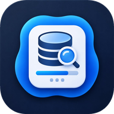

# Storage Tracking Android (v1.0)

<p align="left">
  
</p>

Android 로컬 및 이동식 공유 저장소에서 **어느 폴더와 파일이 저장 공간을 얼마나 사용하고 있는지** 폴더·파일 단위로 정확하고 빠르게 확인하는 읽기 전용 네이티브 Android 애플리케이션입니다.

### 📥 릴리즈 APK 바로 다운로드
- **[📦 storage_tracking_android_v1.0_release.apk 다운로드](https://github.com/cjftya/storage_tracking_android/raw/main/releases/storage_tracking_android_v1.0_release.apk)** ([저장소 내 파일 보기](releases/storage_tracking_android_v1.0_release.apk))

- **기능 기준**: [cjftya/storage_tracking](https://github.com/cjftya/storage_tracking) (v1.2 사양 대응)
- **절대 원칙**: 파일 본문을 읽거나 해시를 계산하지 않으며, 파일을 수정·이동·삭제하지 않습니다.

---

## 1. 스캔 모드 및 주요 기능

### A. Folder scan (기본 모드)
- 선택한 폴더 이하의 **모든 일반 파일의 논리적 크기(`size`)**를 폴더별로 합산합니다.
- 최소 파일 크기 설정과 무관하게 전체 파일을 빠짐없이 집계합니다(폴더 모드에서는 `Min size (MiB)` 입력이 비활성화됨).
- 개별 파일 결과 객체를 메모리에 유지하지 않고 디렉터리 직접 바이트 증분(`DirectoryDelta`)만 조상 폴더에 정확히 한 번씩 누적합니다(`O(결과 폴더 수)` 메모리).
- 0B 하위 폴더는 생략하되 선택한 루트 폴더는 0B여도 표시합니다.
- 스캔 진행 중에는 `Logical size (aggregating)`, 정상 완료 시 `Logical size`, 취소 또는 접근 오류 발생 시 `Logical size (partial)`로 상태를 명확히 구분하며, 완료/취소 후 각 폴더의 자식 목록을 용량 내림차순으로 정렬합니다.

### B. Large file scan (선택 모드)
- 지정한 최소 크기 이상(`>=`, 기본값 **100 MiB = 104,857,600 B**)의 일반 파일을 탐색합니다.
- 일치한 파일과 그 상위 폴더 체인만 결과 트리에 보관합니다(`O(일치 파일 + 상위 폴더)` 메모리).
- 이 모드에서 폴더에 표시되는 크기는 **조건에 일치한 하위 파일들의 합계(`Matched size`)**이며, 전체 폴더 사용량과 혼동하지 않도록 별도 헤더와 안내 문구로 구분합니다.

### C. 공통 기능
- **Material 3 GUI 및 한국어/영어 다국어 지원**: Material 3 카드·버튼·칩·다이얼로그 기반 레이아웃과 한국어(`values-ko`)·영어(`values`) 리소스를 지원합니다. 기기 Day/Night 테마 자동 전환 및 `WindowInsetsCompat` 안전 여백이 적용되어 있습니다.
- **독립 스캐너 아키텍처**: `FolderScanner`/`FolderResultStore`/`FolderScanController`와 `FileScanner`/`FileResultStore`/`FileScanController`는 완전히 분리되어 있으며 결과·인덱스·상태를 공유하지 않습니다.
- **단일 대상 폴더 + 다중 제외 폴더(`Exclusions`) 관리**: 앱 실행 시 현재 Android 사용자 프로필(`0`, 보안 폴더·멀티 유저 `150` 등)의 기본 공유 저장소(`/storage/emulated/<userId>`)를 자동 선택하며, 접을 수 있는 스캔 범위 카드에서 단일 대상 폴더 아래에 여러 제외 경로를 폴더 선택기(`FolderPickerDialog`)로 추가하고 칩(`Chip`)으로 개별 삭제·전체 초기화하거나 직접 입력 편집으로 전환할 수 있습니다.
- **실시간 선형 프로그레스, 용량 비율 막대 및 200개 페이지 지연 로딩**: 스캔 워커는 백그라운드에서 실행되며 스캔 중에는 상단 선형 프로그레스 바(`LinearProgressIndicator`)가 표시되고 UI는 약 1초 주기로 상태와 부분 결과를 갱신합니다. 트리 각 항목에는 부모 기준 상대 사용량 막대가 함께 표시되며, 폴더를 펼칠 때 자식 항목을 200개씩 나누어 표시합니다(`Load next 200…`).
- **폴더 길게 누르기(Long press) 메뉴 및 파일 관리자 선택**: 트리의 폴더를 길게 누르면 **폴더 열기**, **폴더 보고서 내보내기 (.md)**, **제외 목록에 추가**, **경로 복사** 메뉴가 열립니다. 폴더 열기 시 기기에 설치된 파일 관리자 목록을 앱 아이콘과 함께 표시하여 선택 실행할 수 있습니다.
- **Markdown (`.md`) 보고서 내보내기**: 스캔 결과가 있을 때 하단 상태 바의 `Report (.md)` 버튼, 스캔 완료 다이얼로그, 또는 특정 폴더 길게 누르기 메뉴에서 Android SAF 문서 저장소(`CreateDocument`)를 통해 요약·메타데이터·용량 트리/대용량 파일 목록이 포함된 Markdown 보고서를 저장할 수 있습니다.

---

## 2. Android 저장소 권한 및 한계

1. **Android 11 이상 (API 30+)**:
   - 공유 저장소 전체 폴더·파일 메타데이터를 스캔하려면 시스템 설정에서 **모든 파일에 대한 접근 권한(`MANAGE_EXTERNAL_STORAGE`)** 허용이 필요합니다.
   - 앱 상단 배너의 **Grant access** 버튼을 누르면 시스템 설정 화면으로 이동합니다. 권한을 거부하더라도 앱이 강제 종료되지 않으며 접근 가능한 경로 범위 내에서만 동작합니다.
2. **Android 8 ~ 10 (API 26 ~ 29)**:
   - `READ_EXTERNAL_STORAGE` 런타임 권한 및 `requestLegacyExternalStorage="true"` 설정을 통해 공유 저장소에 접근합니다.
3. **플랫폼 보안 제한 영역**:
   - 모든 파일 접근 권한이 허용된 경우에도 Android OS 보안 정책상 다른 앱의 내부 비공개 데이터(`/data/data` 등)와 Android 11+의 `Android/data`, `Android/obb` 하위 보호 영역은 열거가 거부될 수 있습니다.
   - 앱은 이를 우회하거나 루팅 권한을 사용하지 않으며, 접근 거부 건수를 `Errors`에 집계하고 폴더 스캔 결과를 `partial`로 정직하게 표시합니다.
4. **용량 수치의 의미**:
   - 표시되는 용량은 파일의 **논리적 바이트 합계**입니다. 파일시스템 블록 할당 단위, 희소(sparse)/압축 파일, 시스템 예약 공간, 접근 불가 앱 데이터까지 포함하는 기기 설정의 '총 사용 중 저장 공간' 수치와는 차이가 있을 수 있습니다.
   - 심볼릭 링크는 따라가지 않으므로 순환 참조나 링크 중복 합산이 발생하지 않습니다.

---

## 3. 프로젝트 구조

```text
app/src/main/java/com/core/storagetracking/
  ui/                 # MainActivity, FolderPickerDialog, TreeNodeAdapter,
                      # FolderTreeState, FileTreeState, TreeRowItem
  viewmodel/          # ScannerViewModel (모드 전환, 1000ms 주기 폴링, 회전 시 수명 유지)
  scan/
    folder/           # FolderConfig, DirectoryDelta, FolderProgress, FolderSummary,
                      # FolderNode, FolderScanner, FolderResultStore, FolderScanController
    file/             # FileScanConfig, FileMatch, FileScanProgress, FileScanSummary,
                      # FileResultNode, FileScanner, FileResultStore, FileScanController
    common/           # PathPolicy, PathFilter, SizeConverter
  storage/            # StorageAccessManager, StorageVolumeProvider, StorageDiscovery,
                      # StorageVolumeInfo, FolderOpener
  report/             # MarkdownReportGenerator
  util/               # SizeFormatter
```

- 사전 코드 및 환경 분석 문서는 [docs/ANALYSIS.md](docs/ANALYSIS.md)에 정리되어 있습니다.

---

## 4. 빌드, 테스트 및 APK 직접 설치

### 빌드 및 단위 테스트
```powershell
# Release APK 빌드
.\gradlew.bat :app:assembleRelease

# Debug APK 빌드
.\gradlew.bat :app:assembleDebug

# JVM 단위 테스트 및 1k/10k/100k 규모 검증
.\gradlew.bat :app:testDebugUnitTest
```

### APK 다운로드 및 기기 설치
- **GitHub에서 Release APK 바로 다운로드**: [storage_tracking_android_v1.0_release.apk](https://github.com/cjftya/storage_tracking_android/raw/main/releases/storage_tracking_android_v1.0_release.apk)
- **생성된 Release APK 경로**: `app/build/outputs/apk/release/app-release.apk` (또는 `releases/storage_tracking_android_v1.0_release.apk`)
- **생성된 Debug APK 경로**: `app/build/outputs/apk/debug/app-debug.apk`
- **ADB 연결 기기에 직접 설치**:
  ```powershell
  adb install -r releases\storage_tracking_android_v1.0_release.apk
  ```
- 또는 APK 파일을 Android 기기에서 다운로드한 뒤 파일 관리자에서 바로 실행하여 설치할 수 있습니다. 설치 후 앱 상단의 **Grant access**를 눌러 저장소 접근 권한을 허용하고 **Scan / Restart**를 눌러 스캔을 실행합니다.
